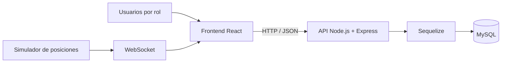

# Gestión de Flota · tesis de grado

**Proyecto académico (2024) · Caso de estudio técnico · Código privado · Sin demo pública verificada**

## El problema

La coordinación de conductores, viajes y reclamos puede quedar fragmentada entre diferentes responsables. El proyecto planteó una aplicación web para reunir esas tareas y ofrecer información según el rol y el área de cada persona.

El objetivo del trabajo fue diseñar e implementar un sistema de gestión operativa. **No se presenta como una solución puesta en producción ni como un sistema GPS real.**

## Qué se implementó

| Módulo | Evidencia en el código |
| --- | --- |
| Usuarios y permisos | Registro, inicio de sesión, JWT y asignación de roles y áreas |
| Viajes | Inicio, cierre, duración e historial diferenciado por permisos |
| Reclamos | Alta, asignación, edición, estados y comentarios |
| Reportes | Consultas agregadas y gráficos de reclamos, con filtros en las vistas correspondientes |
| Mapa experimental | Posiciones **simuladas** transmitidas mediante WebSocket |

En el historial de viajes, el administrador puede consultar el conjunto, el gerente los viajes de su área y el conductor los propios. Esta segmentación se identificó en los controladores de la API; no sustituye una auditoría de seguridad de ejecución.

## Arquitectura

**Frontend:** React, Vite, Material UI, React Router, Axios, Chart.js y Leaflet.

**Backend:** Node.js, Express, Sequelize, MySQL, autenticación JWT y contraseñas verificadas con bcryptjs. La simulación de posiciones utiliza un proceso WebSocket separado.

## Un recorrido representativo

1. Un usuario accede con su cuenta y su rol determina las vistas y operaciones disponibles.
2. Un conductor inicia un viaje y luego registra su cierre.
3. La aplicación permite consultar el historial conforme al rol y área.
4. Los responsables gestionan reclamos, modifican estados y agregan comentarios de seguimiento.
5. Los informes muestran agregados sobre reclamos y conductores.

El recorrido resume funcionalidades presentes en el código. **No constituye una prueba reciente de extremo a extremo.**

## Alcance real y limitaciones

- La revisión del **12 de noviembre de 2026 fue estática**: se leyeron frontend, backend y documentación, pero no se levantó el sistema completo.
- El mapa recibe **posiciones simuladas**. No se comprobó seguimiento GPS de vehículos reales.
- La integración final de alertas está pendiente; el módulo de notificaciones no entrega avisos reales.
- Algunos imports, rutas, consultas e invariantes de autorización necesitan correcciones antes de una ejecución demostrable.
- La exploración React Native fue incompleta y **no forma parte de la aplicación web terminada**.
- No hay evidencia suficiente para afirmar optimización de rutas, mantenimiento predictivo, ahorro económico medido o utilización en producción.

## Cómo se podría mostrar

La evidencia siguiente sería valiosa **después de prepararla y revisarla**:

1. Capturas de las pantallas de acceso, viajes, reclamos y reportes, con datos de prueba.
2. Grabación breve de un recorrido por roles.
3. Demo aislada con MySQL y usuarios ficticios, una vez resueltos los problemas técnicos indicados.

Existen capturas históricas en los materiales académicos, pero no se incluyen aquí hasta revisar que no contengan información identificatoria o de terceros.

## Qué demuestra el proyecto

Diseño de una solución desde los requerimientos, separación frontend/backend, modelado relacional, controles por rol, consultas para reportes y documentación de una aplicación de varias áreas funcionales.

---

[Volver al portfolio de GitHub](../README.md) · **Código fuente:** privado (frontend y backend separados).
